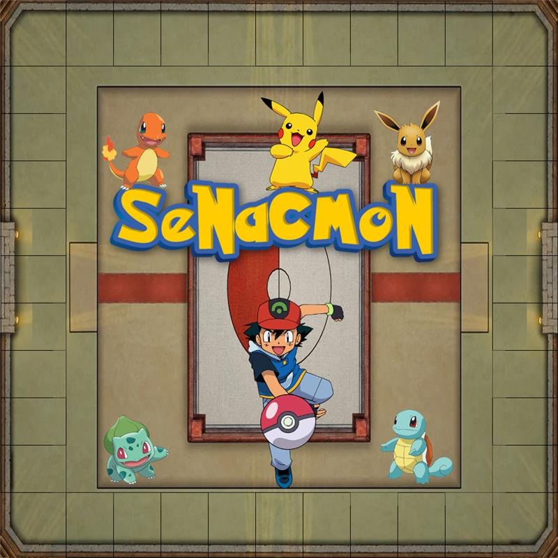

# Senacmon

Jogo de tabuleiro web com tema de Pokémon, feito em Django. Foi meu projeto final do curso de Python do Senac.

Você escolhe um Pokémon inicial (água, fogo ou planta), rola o dado e vai andando pelo mapa. Cada casa tem um efeito: algumas dão berries, outras tiram, umas iniciam batalha e, se der azar, a Equipe Rocket te captura e você fica 2 rodadas sem jogar. A partida termina quando acabam as rodadas ou quando suas berries zeram.



## Regras

- Todo jogador começa com 100 berries
- O dado vai de 1 a 6
- Casas do mapa: **neutra**, **bônus**, **perda**, **batalha** e **captura**
- Na batalha vale o esquema pedra-papel-tesoura dos elementos: água ganha de fogo, fogo ganha de planta, planta ganha de água
- Antes da batalha dá pra apostar berries escolhendo um ou dois números. Acertando com um número o prêmio é 3x, com dois é 1.8x, e a vantagem (ou desvantagem) de elemento mexe nesse multiplicador. Também dá pra batalhar sem apostar
- Todas as entradas e saídas de berries ficam registradas no extrato

## Tecnologias

- Python e Django 5.2
- SQLite para rodar local e PostgreSQL em produção
- Templates do Django (HTML/CSS)
- Whitenoise para arquivos estáticos e Gunicorn para deploy

## Estrutura

O projeto é dividido em apps do Django:

```
src/
├── accounts/   cadastro, login e perfil
├── wallet/     saldo e extrato de berries
├── game/       partida, mapa, batalhas
│   ├── domain/     regras do jogo, validações e exceções
│   ├── services/   lógica de partida, zonas, apostas e batalha
│   ├── models/
│   └── views/
├── common/     páginas gerais e comandos para popular o banco
└── config/     settings e urls
```

Tentei deixar as regras do jogo fora das views: a view só recebe a requisição e chama os services, e as regras ficam em `game/domain`. Assim fica mais fácil de testar e mudar uma regra sem mexer na interface.

## Como rodar

```bash
git clone https://github.com/Rafael-Ramalho-code/Pymonn.git
cd Pymonn

python -m venv venv
source venv/bin/activate      # no Windows: venv\Scripts\activate
pip install -r requirements/requirements-dev.txt

python src/manage.py migrate
python src/manage.py seed_senacmon          # cria os Pokémon e o mapa
python src/manage.py seed_extras_senacmon   # opcional
python src/manage.py runserver
```

Depois é só abrir http://127.0.0.1:8000, criar uma conta e começar uma partida.

Se tiver `make` instalado, `make migrate` e `make demo` fazem a mesma coisa.

### Usando PostgreSQL

Por padrão o projeto usa SQLite. Para usar Postgres, crie um arquivo `.env` na raiz:

```
USE_POSTGRES=1
DB_NAME=senacmon
DB_USER=seu_usuario
DB_PASSWORD=sua_senha
DB_HOST=localhost
DB_PORT=5432
```

## Comandos úteis

| Comando | O que faz |
|---|---|
| `make demo` | Reseta tudo e popula o banco de novo |
| `make reset-user USER=nome` | Apaga partidas, batalhas e transações de um usuário |
| `python src/manage.py senacmon_demo` | Cria uma partida que joga sozinha (usei para apresentar em aula) |

## Próximos passos

- Escrever testes automatizados para os services
- Modo com mais de um jogador na mesma partida
- Ranking dos jogadores
